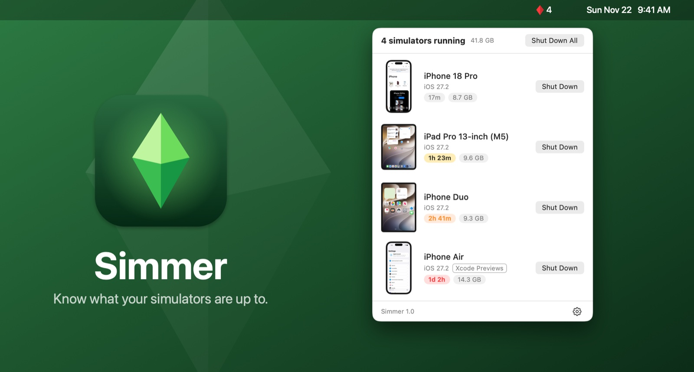
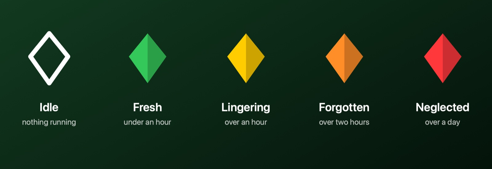
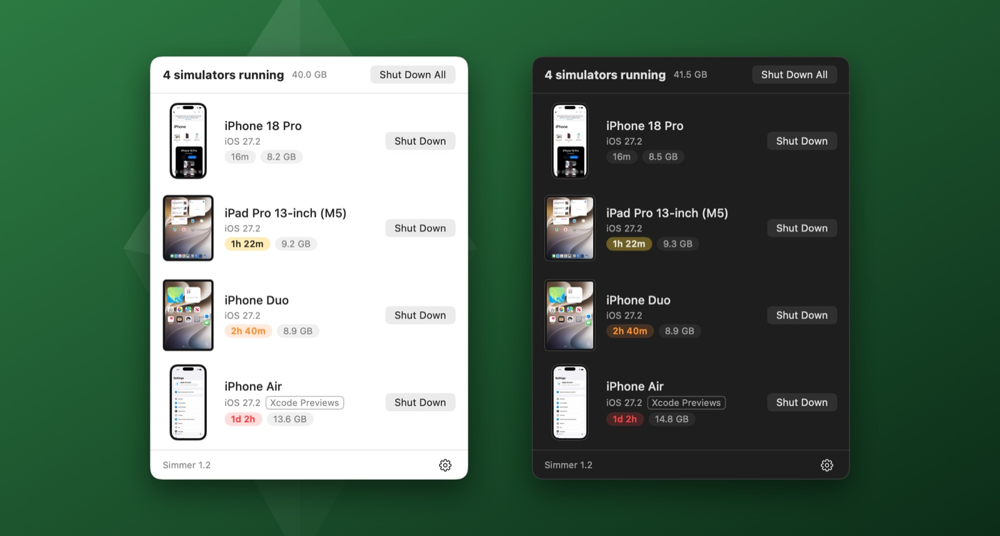

<picture>
  <source media="(prefers-color-scheme: dark)" srcset="docs/hero-dark.jpg">
  
</picture>

# Simmer

A tiny Mac menu bar app that shows which Xcode simulators are running, and lets you shut them down with one click.

Simulators are easy to forget. Close the Simulator window, or let Xcode start one for a preview, and it can keep running out of sight for days, heating up your Mac and draining the battery. Simmer keeps a count in your menu bar so you always know.

## Install

1. **[Download Simmer](https://github.com/mattbirchler/Simmer/releases/latest/download/Simmer.dmg)**
2. Open **Simmer.dmg** from your Downloads folder. A window appears with Simmer on the left and your Applications folder on the right.
3. Drag **Simmer** onto **Applications**.
4. Open **Simmer** from Applications.

That's it. Look for a small gem at the top right of your screen, near the clock. Simmer has no Dock icon and no window, so the menu bar is where it lives.

Simmer needs macOS 14 or newer, and Xcode (which is where simulators come from).

## Use

- **The gem** is hollow when nothing is running. When simulators are running it fills in, with a number beside it saying how many.
- **The gem's color** tells you how things are going. Green means everything was started within the hour. It turns yellow after an hour, orange after two (which usually means one was forgotten), and red after a day.



- **Click the gem** to see each one, with a live picture of what's on its screen, how long it has been running, and how much memory it is holding. The top of the menu shows the total.
- **Click Shut Down** next to a simulator to turn it off, or **Shut Down All** to turn them all off at once.
- **Click the gear** and choose **Open at Login** so Simmer starts by itself whenever you turn on your Mac.
- **Choose Notify About Forgotten Simulators** from the gear to get a notification when one passes the two hour mark, with a Shut Down button on it. macOS asks for your permission the first time.

The gem also turns orange when your Mac is getting short of memory while simulators are running, and red when it is nearly out, however long they have been on.



## Questions

**Will shutting down a simulator lose my work?**
No. It's the same as choosing Device > Shut Down in the Simulator app. Your apps and their data are still there the next time you start it.

**What do "Xcode Previews" and "Test run" mean?**
Xcode sometimes starts simulators on its own, to draw SwiftUI previews or to run tests. These never show a window, so they are the easiest to miss. Simmer tags them so you know where they came from. They are safe to shut down. Xcode starts a new one when it needs it.

**Does Simmer itself use much battery?**
No. It takes a quick look at the list of running apps every few seconds, which costs next to nothing. It only takes pictures of simulator screens, and adds up their memory, while its menu is open.

**Why is the memory figure so large?**
It adds up every process running inside each simulator, the same way Activity Monitor's Memory column does, and a simulator is a whole copy of iOS. Memory that macOS has compressed or moved to disk is counted too, so the total can be more than your Mac has installed.

**How do I get new versions?**
Simmer checks for updates once a day. When there is one, an **Update** button appears at the bottom of its menu. Click it to see what's new and install it. You can also check any time from the gear, with **Check for Updates…**.

**How do I remove it?**
Click the gem, then the gear, choose Quit Simmer, then drag Simmer from Applications to the Trash.

## For developers

Simmer is a small SwiftUI app. To build it yourself:

```sh
git clone https://github.com/mattbirchler/Simmer.git
cd Simmer
open Simmer.xcodeproj
```

Then press Run in Xcode. No developer account is needed.

How it works: every booted simulator has a `launchd_sim` process whose arguments point into the device's folder. Simmer finds those in the process list, reads the device's name and system version from its `device.plist`, and uses `xcrun simctl` to take screenshots and shut devices down. See [`SimulatorScanner.swift`](Simmer/SimulatorScanner.swift).

The project file is generated from `project.yml` with [XcodeGen](https://github.com/yonaskolb/XcodeGen). If you add or remove files, run `xcodegen generate`. Updates are delivered with [Sparkle](https://sparkle-project.org). Each GitHub release carries an `appcast.xml` beside the disk image, and Simmer reads the one on the latest release. Development builds never check.

To ship a version, raise `MARKETING_VERSION` and `CURRENT_PROJECT_VERSION` in `project.yml`, write a few lines of release notes for people in a Markdown file, and run `scripts/publish.sh notes.md`. That runs `scripts/release.sh`, which makes the signed, notarized disk image and the update feed, then creates the release. It needs [create-dmg](https://github.com/create-dmg/create-dmg) (`brew install create-dmg`) and the Sparkle signing key in your keychain under the account `simmer`. The disk image's background is drawn by `scripts/make-dmg-background.swift`.

The app icon comes in two forms. `Simmer/AppIcon.icon` is the layered one that macOS 26 and later draw with their glass, dark and tinted styles, and it opens in Icon Composer. `scripts/make-icon.swift` draws the flat pictures that earlier versions of macOS show.

Issues and pull requests are welcome.

## License

[MIT](LICENSE)
